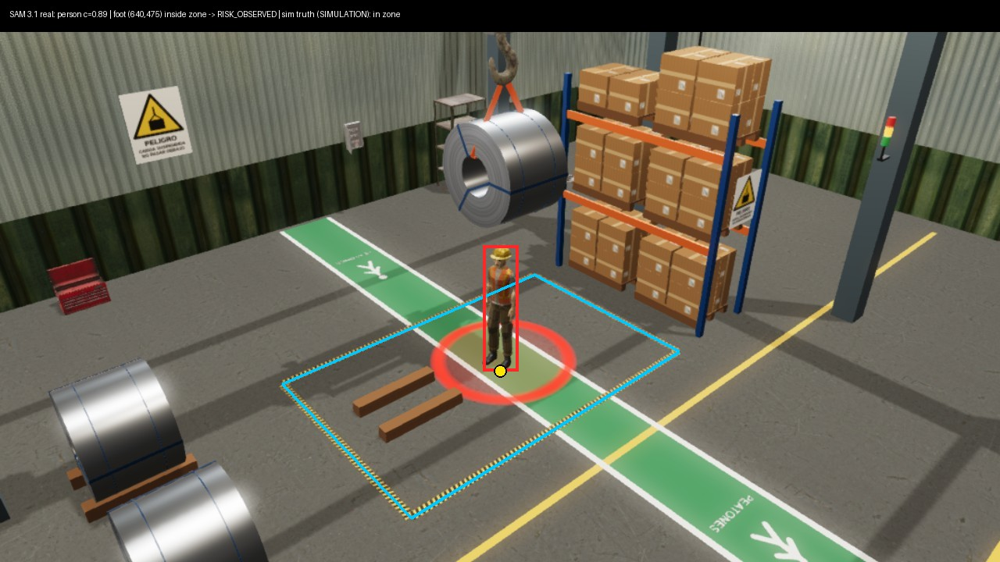

# SAM 3.1 — real results

Only real model outputs are listed here, failures included. The simulator's
ground truth is shown next to each result, labeled SIMULATION, to *measure*
the model; it is never fed to the model or used to decide.

## Run 1 — 2026-11-03, first real call

| | |
|---|---|
| Model | `sam-3.1` via `POST https://api.meta.ai/v1/responses`, Standard mode, `store:false` |
| Prompt | `person` |
| Input | CAM-01 frame `f-20261103T165838413-d307c6.jpg`, 1280×720 JPEG, scene `crane-v1`, SHA-256 `ef303af04d7ec23713690f2b99f99ee1812c99269cfe84f387a7e667d7c70a45` |
| Raw output | `<|box;x1=618;y1=314;x2=663;y2=475;w=1280;h=720;c=0.887|>` + one-bit mask |
| Latency | 2.4 s (measured end to end from a dev machine) |
| Usage reported | `images_processed: 1` |
| Zone rule | foot point (640.5, 475) inside the calibrated `crane-v1` polygon |
| Decision | **`RISK_OBSERVED`** ⇒ the virtual PLC would block the start |
| Simulator truth (SIMULATION) | `operatorInZone: true` — agrees |
| Cost | US$0.0025 estimated (1 image at US$2.50 / 1,000), from promotional credits |

Files: [`results/`](results/) holds the frame, its evidence JSON and the full
response (`.sam.json`, SHA-256 `eb4c76d4856e55e4430d3bdc6b9fa37039b9b5ae34daf8ef1c00ff7ea3db12df`). The overlay above is drawn afterwards
from that response; the model never saw it.

**What this does and does not show.** One frame, one person, good light, a
rendered scene. It shows the pipeline works end to end with a real Meta model
on real rendered pixels. It is not an accuracy measurement and not a safety
claim. This first call was made with a one-off tool (`apps/api/src/tools/sam-once.ts`)
against a frame stored by the app while Meta was off, which is why the frame's
evidence JSON says `INFERENCE_DISABLED`; the scene was the earlier `crane-v1`.
Since then the app itself calls SAM live on every ENERGIZE when
`META_API_ENABLED=true` (that is what the demo video shows).

## Live runs in the app (Nov 3–4, 2026)

| | SAM 3.1 | Muse Spark 1.3 |
|---|---|---|
| Real requests | 18 (plus the first one above) | 8 |
| Agreement with the simulator truth | 19 of 19 (10 inside, 9 outside) | its "person in the zone?" matched SAM in 5 of 5 answers |
| Failures | none | 3 `incomplete`: reasoning used up the output cap (2 at 300 tokens, 1 at 2,048); now 4,096 |
| Latency | ~2.4 s, in front of the decision | ~10–13 s, after the decision (it never delays the PLC) |

Example of what Spark wrote for a blocked start, from the same frame SAM saw:

- To the technician's watch: *"DANGER: Operator trying to energize crane PG-01! Move out of work zone now, you are under the load!"*
- To the operator: *"Blocked: worker in yellow helmet standing inside work zone by crane hook next to steel coil."*

Same caveat as above: one scene, two positions, good light. Not an accuracy claim.
